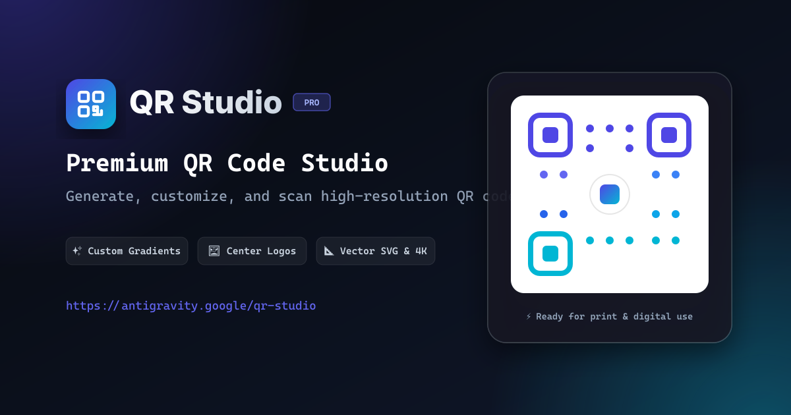

# QR Studio — Modern QR Code Generator & Scanner

[](https://github.com/maidacencoanastasia/link_to_qr/actions/workflows/deploy.yml)

An elegant, high-performance web application to generate, customize, and scan QR codes in real-time.

🌐 **Live Demo:** [https://maidacencoanastasia.github.io/link_to_qr/](https://maidacencoanastasia.github.io/link_to_qr/)



## ✨ Features

- **Instant Real-Time Preview**: Live QR generation as you type links or text.
- **Multiple Payload Types**:
  - 🌐 **Website URL**: Smart protocol auto-formatting (`https://`) and one-click clipboard paste.
  - 📶 **Wi-Fi Network**: Supports WPA/WPA2/WPA3, WEP, and Open networks with hidden SSID option.
  - 📝 **Plain Text**: Formatted text notes with real-time character counter.
  - 📧 **Email**: Pre-filled recipient, subject, and body (`mailto:`).
  - 👤 **vCard / Contact**: vCard 3.0 generation for seamless phone contact importing.
  - 💬 **Phone / SMS**: Pre-filled phone numbers and text messages.
- **Deep Customization Studio**:
  - **Colors & Gradients**: Solid colors, Linear diagonal & Radial gradients, curated palettes (Obsidian, Cyber Cyan, Neon Violet, Sunset Blaze, Emerald, Royal Indigo), and transparent backgrounds.
  - **Shapes & Dots**: Rounded, Circles, Classy, Classy Smooth, Square, and Pill Fluid body dots + customizable corner frames.
  - **Logos & Branding**: Upload custom brand logos/images or pick from built-in vector icons (Link, GitHub, Twitter/X, YouTube, Instagram, Wi-Fi) with background dot cutout controls.
  - **Error Correction**: Configurable recovery levels (L 7%, M 15%, Q 25%, H 30%).
- **High-Resolution Exports**:
  - **PNG**: 512px, 1024px, 2048px (Ultra-HD), and 4096px (Print Master).
  - **SVG**: Crisp scalable vector format for graphic designers and large format prints.
  - **Copy Image**: One-click copy image to system clipboard.
  - **Print**: Print-ready dialog formatted for standard printers.
- **Built-in QR Scanner & Reader**:
  - Drag & drop QR code images or paste directly from clipboard (`Ctrl + V`) to decode.
  - Instant "Open in Browser", "Copy Text", and "Customize in Generator" actions.
- **Recent History**:
  - Automatically saves recently generated codes to `localStorage` with thumbnails, timestamps, and one-click reload.

## 🚀 Running Locally

```bash
# Install dependencies
npm install

# Start local development server
npm run dev
```

Open your browser at `http://localhost:5173`.

## 🐳 Docker Deployment

You can containerize and run the application using Docker or Docker Compose.

### Option 1: Docker Compose (Recommended)

Start the container in detached mode:
```bash
docker compose up -d
```
Access the application at **`http://localhost:8080`**.

To stop the container:
```bash
docker compose down
```

### Option 2: Docker CLI

1. **Build the Docker image**:
   ```bash
   docker build -t qr-studio .
   ```

2. **Run the container**:
   ```bash
   docker run -d -p 8080:80 --name qr-studio qr-studio
   ```

3. **Access**:
   Open **`http://localhost:8080`** in your browser.

4. **Stop and remove container**:
   ```bash
   docker stop qr-studio && docker rm qr-studio
   ```

